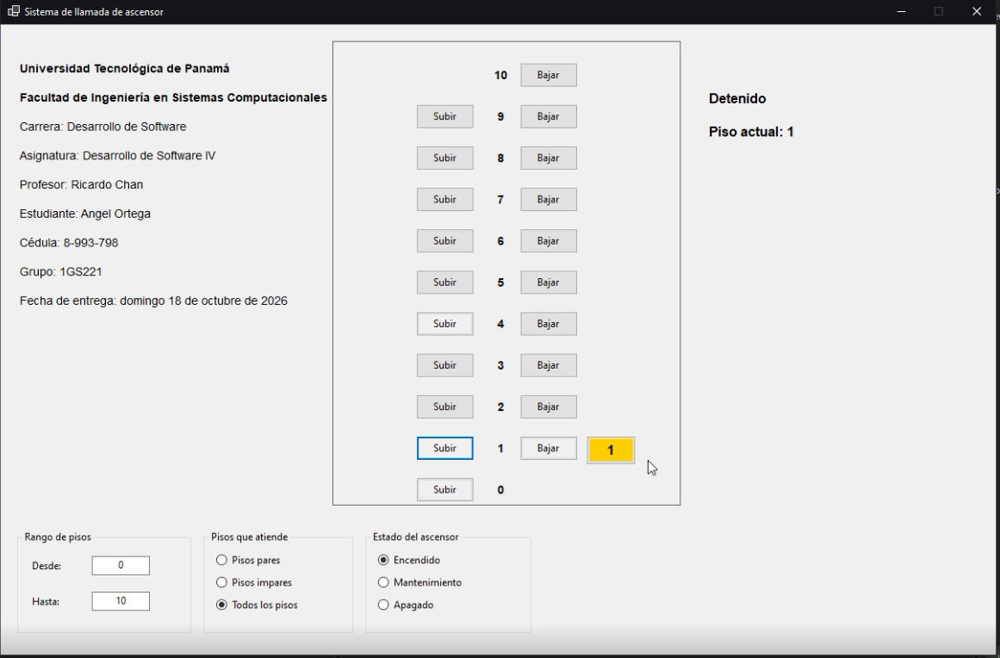
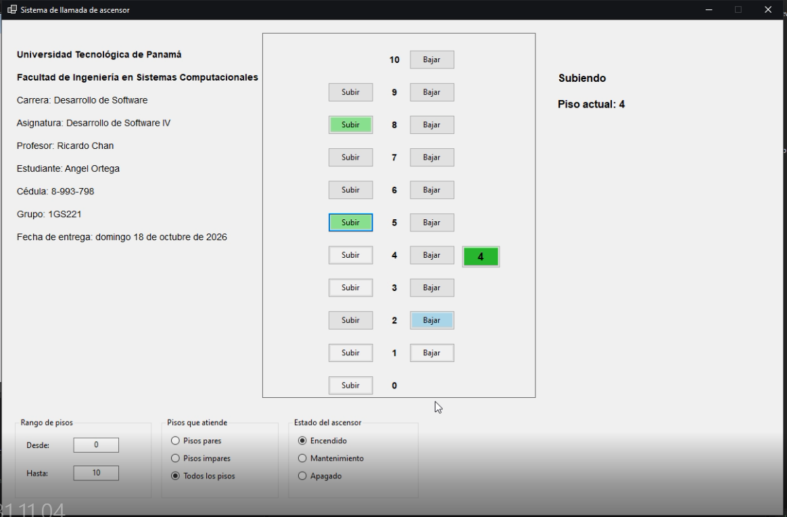
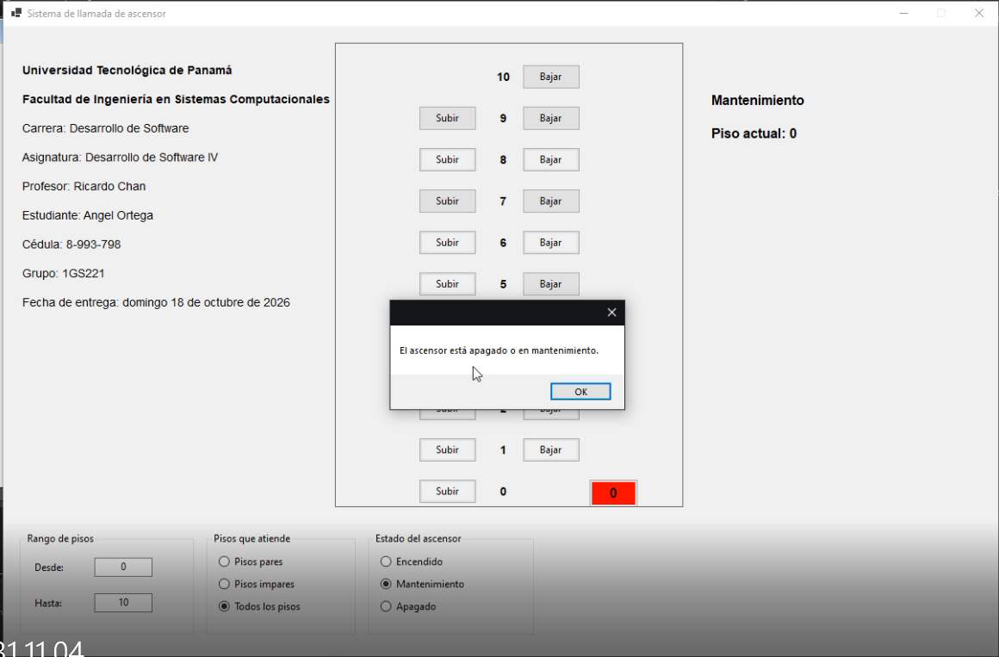

# 🛗 Sistema de Monitoreo y Control de Llamadas de Ascensor (C# / .NET)

Aplicación de escritorio desarrollada en **C# (Windows Forms)** que simula en tiempo real el algoritmo de despacho y control de un ascensor de 11 niveles (Planta Baja 0 al Piso 10), aplicando generación dinámica de controles mediante arreglos, cálculo matemático de posiciones y planificación inteligente de rutas (algoritmo SCAN).

🔗 **Portafolio Principal:** <https://aortegadevpa.github.io/>

---

## 📸 Capturas de Funcionamiento

| Estado en Espera (Detenido) | Desplazamiento Activo (Subiendo) | Control de Mantenimiento / Bloqueo |
| :---: | :---: | :---: |
|  |  |  |

---

## ⚙️ Arquitectura y Características Técnicas

* **Generación Dinámica de Interfaz (UI Procedural):**
  * Creación automática de los indicadores de piso (`Label`) y botones de llamada (`Subir` / `Bajar`) mediante arreglos unidimensionales y ciclos `for` con cálculo matemático de coordenadas (`Location`), evitando código repetitivo o condicionales innecesarios.
* **Algoritmo Inteligente de Despacho (Subida y Bajada Intercalada):**
  * **Atención prioritaria por sentido:** Si el ascensor sube, atiende en orden ascendente todas las llamadas de subida pendientes antes de invertir dirección (y viceversa al bajar), evitando regresos innecesarios.
  * **Balanceo de tráfico:** Alterna entre solicitudes de subida y bajada cuando existen llamadas simultáneas en ambos sentidos.
  * **Cálculo matemático de piso en tiempo real:** Determina el nivel exacto de la cabina según su coordenada vertical `Y` sin utilizar cadenas extensas de `if/else`.
* **Estados Visuales de Cabina:**
  * 🟢 **Verde (`Subiendo` / `Bajando`):** Desplazamiento activo hacia el piso objetivo.
  * 🟡 **Amarillo (`Detenido`):** Pausa temporizada de 3 segundos al llegar a un piso solicitado o en espera.
  * 🔴 **Rojo (`Mantenimiento` / `Apagado`):** Bloqueo operativo inmediato con notificación visual al intentar realizar llamadas.
* **Filtros Operativos Configurables:**
  * **Rango de operación (`Desde` - `Hasta`):** Restringe dinámicamente los pisos habilitados con validación de límites.
  * **Paridad de pisos (`Pares`, `Impares`, `Todos`):** Filtra qué niveles puede atender el ascensor en tiempo real.

---

## 🛠️ Tecnologías Utilizadas

* **Lenguaje:** C# (.NET Framework / .NET Windows Forms)
* **Paradigma:** Programación Orientada a Objetos (POO) y Manejo de Eventos/Timers
* **IDE:** Visual Studio

---

## 🚀 Cómo Ejecutar el Proyecto

1. Clona este repositorio o descarga el código fuente:
   ```bash
   git clone https://github.com/aortegadevpa/simulador-elevador-csharp.git
   ```
2. Abre el archivo de solución (`.sln`) en **Visual Studio**.
3. Presiona **`F5`** (o haz clic en **Iniciar**) para compilar y ejecutar el simulador.

---

👤 **Desarrollado por:** [Angel Ortega](https://aortegadevpa.github.io/) — Ingeniería de Desarrollo de Software (UTP, Panamá)